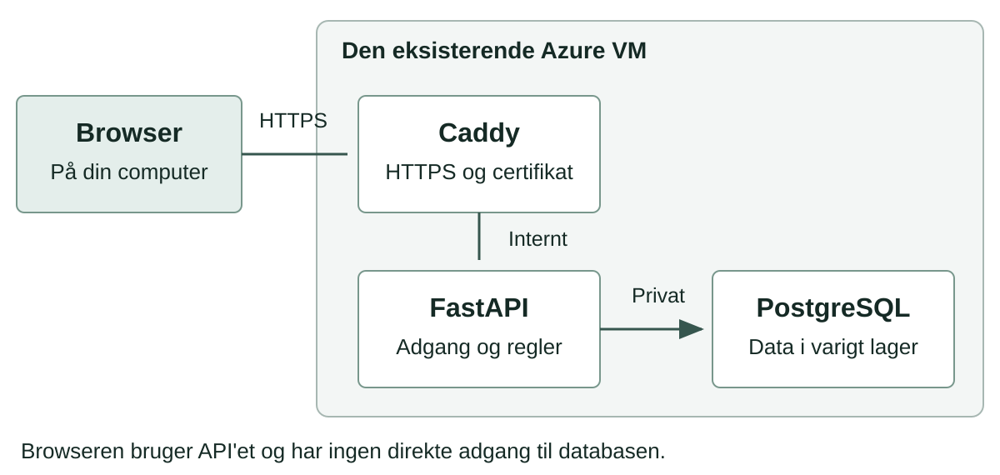

# Aeris projektet forklaret

Arbejdet den 6 og 7 november 2026

Vi har bygget en prototype, hvor en tekniker kan undersøge vindmålinger, se en mulig fejl, vurdere fremtidige risici og følge en vedligeholdelsessag. Den hedder Aeris. Man kan åbne den i en almindelig browser, men bag skærmbilledet ligger et program, en database og en server hos Microsoft Azure.

Denne gennemgang forklarer arbejdet uden at forudsætte kendskab til kode, GitHub eller servere. Fagord bliver forklaret, når de optræder. Undervejs forbinder vi de konkrete valg med undervisningen. Kildernes korte navne, for eksempel A1 og C1, er samlet til sidst.

**Det vigtigste at vide:** Arbejdsgangen, adgangskontrollen og lagringen virker. Målingerne er øvelsesdata, prognosens tal er faste illustrationer, og vedligeholdelsesresultaterne er simulerede. Prototypen styrer ikke en rigtig vindmølle og foretager ikke en virkelig AI-analyse.

Den afprøvede adresse er https://aeris-studiegruppe-linux.swedencentral.cloudapp.azure.com/. VM'en skal være tændt, for at dashboardet kan hente og gemme data. Den blev startet og kontrolleret den 7. november og derefter stoppet og deallokeret igen for at begrænse forbruget.

## 1 Fra forretningsbehov til en afgrænset prototype

Forestil dig en vindmølle, der oplever et kraftigt vindstød. En tekniker har brug for at se, hvad målingerne viser, om der allerede er en fejl, og hvilke fremtidige problemer der bør undersøges. Hvis oplysningerne ligger spredt, bliver vurderingen vanskeligere. Aeris samler dem i et dashboard, altså en skærm med overblik og handlemuligheder.

Projektet bygger videre på gruppens domænearbejde fra delopgave 1. Et **domæne** er her et afgrænset forretningsområde med sine egne opgaver og begreber. I vores model ejer Predictive Maintenance målingerne, fejlhændelsen, den vurderede prognose og den oprindelige sag. Better Maintenance skulle i den større model håndtere arbejdsordrer og udførelse af arbejdet. Gruppen valgte udtrykkeligt kun at bygge Predictive Maintenance i denne prototype. (A1, side 1; D1; T1.)

Det er derfor et bevidst valg, at man ikke kan planlægge teknikernes vagter eller fordele arbejdsordrer. Vi demonstrerer i stedet et tydeligt mærket resultat, der forestiller at komme fra et andet system. På den måde kan vi afprøve, hvordan den oprindelige sag afsluttes, uden også at bygge det andet forretningsområde.

Et **MVP** er en lille, fungerende udgave, som gør det muligt at afprøve en bestemt idé. Det betyder ikke, at vigtige regler kan springes over. Det betyder, at vi vælger et overskueligt forløb, som hænger sammen fra inddata til gemt resultat. Undervisningens princip om løbende videreudvikling begrunder netop at begynde med de nødvendige dele og forbedre dem efter feedback. (C1, side 11.)

**Krav og valg skal holdes adskilt.** Opgaven kræver blandt andet et tilgængeligt REST API, mindst ét hændelsesforløb og en regel, en separat database samt CI/CD. Den kræver ikke vores grønne design, navnet Aeris, PostgreSQL, en bestemt Git-strategi eller en grænse på 28 m/s. Det er gruppens implementeringsvalg. (A1, side 1-2; A2, side 4-5.)

## 2 Sådan bevæger en sag sig gennem løsningen

Vores eksempel følger én demonstrationsturbine, WT-017. En **måling** består blandt andet af en værdi, en enhed og et tidspunkt. En måling på 28,1 m/s fortæller således noget andet end tallet 28,1 alene.

1. **Opret et syntetisk hændelsesforløb.** Dashboardets High-wind event opretter en ny samling øvelsesmålinger. Tidligere forløb bliver bevaret.
2. **Gem og vurder datakvaliteten.** Målinger med manglende eller ugyldige værdier beholdes som ugyldige, men bruges ikke til analysen. Ingen brugbare målinger betyder, at vurderingen må afvente bedre data. Det betyder ikke, at møllen er fejlfri.
3. **Undersøg den aktuelle fejl.** En brugbar vindmåling skal være strengt større end 28,0 m/s for at udløse vores demonstrationsregel. 28,0 udløser den ikke; 28,1 gør. Grænsen er et eksempel og ikke en fagligt valideret sikkerhedsgrænse for en vindmølle.
4. **Vis den simulerede prognose.** Programmet viser to faste eksempler på fremtidige risici. Sandsynlighederne og tidshorisonterne kommer ikke fra en trænet model. Fejlvurderingen og prognosen bygger på samme datavindue og kan afklares i forskellig rækkefølge.
5. **Lad et menneske vurdere prognosen.** Brugeren accepterer eller afviser hver risiko og skriver en begrundelse. Vurderingen gemmes sammen med det navn, brugeren selv skriver.
6. **Opret den prædiktive sag.** Programmet kræver både en aktuel fejlhændelse og en gennemgået prognose for det samme forløb. Man kan godt afvise begge fremtidige risici og stadig oprette en sag om den observerede fejl.
7. **Registrer et simuleret resultat udefra.** Et mislykket eller ufuldstændigt resultat holder sagen åben. Den bliver først løst, når alt krævet arbejde er angivet som færdigt, og den simulerede verificering er bestået.

Vi gemmer også en tidslinje over det, der er sket. For eksempel er Review Failure Forecast en anmodning om at udføre en handling, mens Failure Forecast Reviewed beskriver, at vurderingen er gennemført. I undervisningen kaldes sidstnævnte en **domain event**, en betydningsfuld hændelse i forretningen. Derfor navngives den som noget, der allerede er sket. (C5, side 42; D1.)

Denne sammenhæng gør diagrammet fra delopgave 1 synligt i den faktiske brugeroplevelse. Reglerne ligger også i programmet. Det er ikke tilstrækkeligt blot at skjule en knap, fordi nogen ellers kunne forsøge at kalde API'et direkte.

Den tidligere domænemodel nævner også andre mulige forløb, for eksempel akut overdragelse uden en prognose. De beskrives som forslag, der skal valideres. Prototypen følger den konkrete kombinationsmodel, som gruppen valgte: både fejlhændelse og gennemgået prognose før en sag. Vi har ikke implementeret alle forslagene i den bredere model. (D1; T1.)

## 3 Hvad der sker bag skærmen

**Frontend** betyder den del, brugeren ser og klikker på. I Aeris er det almindelige HTML-, CSS- og JavaScript-filer. HTML giver siden indhold og struktur, CSS bestemmer udseendet, og JavaScript får knapper og visninger til at reagere.

**Backend** er programmet bag siden. Vi bruger Python og FastAPI. Python er programmeringssproget, og FastAPI hjælper programmet med at modtage og besvare forespørgsler. Backend kontrollerer adgang og indhold, håndhæver reglerne og gemmer ændringer.

Et **API** er en aftalt måde at tale med et program på. Dashboardet kan for eksempel bede om en sag eller sende en vurdering. Et REST API bruger webforespørgsler til det. Et GET-kald henter oplysninger; et POST-kald anmoder typisk om at oprette noget; et PUT-kald bruges her til at gemme en vurdering. Man behøver derfor ikke sidde ved serverens tastatur for at bruge funktionerne.

**PostgreSQL** er vores databaseprogram. Det opbevarer målinger, vurderinger, sager og hændelser. At gemme data varigt kaldes **persistens**. Opgaven kræver en separat database, og vi har derfor en særskilt databasetjeneste. Det kræver ikke en ekstra virtuel maskine. (A1, side 2; A2, side 4-5.)

På Azure går forbindelsen først gennem **Caddy**, som håndterer HTTPS og sender forespørgslen videre til programmet. En sådan mellemstation kaldes en reverse proxy. Databasen er ikke åben direkte på internettet. Browseren skal gennem API'et, som kan kontrollere regler og adgang.

Vi har delt koden op efter ansvar. De små domæneregler kan testes uden en browser. HTTP-håndtering og inddata ligger for sig, og databasearbejdet ligger i andre moduler. Det gør det lettere at forstå, hvor en fejl eller ændring hører til. Det følger undervisningens fokus på sammenhængende ansvar og tydelige grænser. Det er stadig én lille applikation; hvert fagligt begreb er ikke gjort til sin egen server. (C1, side 6-8 og 18; C5, side 16 og 36.)

## 4 Projektmappen og GitHub har forskellige opgaver

Projektet ligger i en mappe på din Mac inde i den eksisterende skolemappe. Den konkrete kode ligger i undermappen delopgave2-iot-mvp. Word-dokumenter og undervisningsmateriale kan godt ligge ved siden af. De bliver ikke automatisk sendt til GitHub, blot fordi de ligger i samme overordnede skolemappe.

Et **repository**, ofte forkortet repo, er projektets filer sammen med deres ændringshistorik. **Git** er værktøjet, der holder styr på historikken. **GitHub** er den fælles onlinetjeneste, hvor gruppen opbevarer og samarbejder om repoet. I DDD-undervisningen findes også et mønster med navnet Repository. Det handler om adgang til forretningsdata og er et andet begreb end vores GitHub-repo. (C5, side 41.)

| Handling | Hvad handlingen betyder | Hvor det sker |
| --- | --- | --- |
| Clone | Hent projektet og dets historik første gang | Fra GitHub til din computer |
| Commit | Gem en navngiven ændring i historikken | På din computer |
| Push | Send dine commits til det fælles repo | Fra din computer til GitHub |
| Pull | Hent og indarbejd nye ændringer fra repoet | Fra GitHub til din computer |
| Pull request | Foreslå at samle en arbejdsgrens ændringer med main | På GitHub |
| Merge | Saml de foreslåede ændringer med målgrenen | På GitHub eller med Git |

En **branch**, på dansk en gren, er et arbejdsspor i samme projekt. Vi bruger main til den fælles version og korte arbejdsgrene til en afgrænset ændring. Det er en enkel GitHub Flow-arbejdsform. Vi har ikke indført en permanent develop-gren eller den mere omfattende GitFlow-model.

Forskellen mellem push og en pull request er vigtig: Et push sender arbejdet til GitHub, men samler ikke i sig selv en arbejdsgren med main. Pull requesten gør ændringen synlig til gennemgang. Først en merge samler den med main. At merge kildekode starter heller ikke automatisk en ny version på Azure-VM'en i vores nuværende opsætning.

## 5 Samarbejde og den konkrete ejerbeslutning

Den normale aftale er, at én person løser en lille opgave på en arbejdsgren, og en anden i gruppen gennemgår ændringen før merge. Gruppen kan bruge forskellige AI-værktøjer og egne computere, men bør fordele opgaverne, så flere ikke ændrer det samme uden aftale. Hver person arbejder med sin egen GitHub-konto og sin egen lokale kopi.

Vi ønskede også tekniske **guardrails**, altså regler som GitHub selv håndhæver. De planlagte regler er en pull request, én anden godkendelse, beståede checks, afsluttede reviewdiskussioner og beskyttelse mod at overskrive historikken med force push eller slette main. Nye ændringer skulle desuden gøre en gammel godkendelse ugyldig.

Da vi forsøgte opsætningen natten mellem den 6. og 7. november, viste kontoen GitHub Free. GitHub advarede om, at reglerne ikke ville blive håndhævet på det private repo under den aktuelle plan. Reglen blev forberedt, men gemningen standsede ved krav om at bekræfte adgang. Johan valgte at lade den ligge til senere. Vi regner derfor fortsat ikke main som verificeret beskyttet.

Den 7. november var Johan den eneste tilgængelige fra gruppen og bad om at fortsætte. GitHub tillader ikke, at en PR-forfatter godkender sin egen PR. PR #4 blev derfor merged som en udtrykkelig **ejerbeslutning efter fem beståede checks**. Mergebeskrivelsen registrerer undtagelsen. Den siger ikke, at en anden person har gennemgået ændringen. Den normale aftale om uafhængigt gruppereview er stadig udgangspunktet. (W1; P4.)

Det betyder også, at grønt lys fra tests og en ejers beslutning har forskellige roller. Tests kan afprøve bestemte situationer. En anden person kan spørge, om løsningen overhovedet løser den rigtige opgave, og om den er forståelig. Vi bør derfor stadig lade et andet gruppemedlem se ændringen, når vedkommende er tilgængelig.

## 6 Test og automatisk kontrol

En **test** er en kontrolleret afprøvning med et forventet resultat. Vores grænseregel kan for eksempel afprøves med 27,9, 28,0 og 28,1 m/s. Der er også tests af forkert input, manglende adgang, sagens regler og lagring i en rigtig PostgreSQL-database.

På den udgivne prototype bestod **43 applikationstests** og **11 tests af hjælpescripts og projektvejledning**. Databasetests bruger deres egen midlertidige testdatabase. De må ikke rydde den fælles demodatabase for at få et grønt resultat. Et grønt testresultat er dokumentation for de afprøvede tilfælde, ikke bevis for at alle tænkelige fejl er væk.

**GitHub Actions** er GitHubs tjeneste til automatisk arbejde. Opskrifterne ligger i projektet som pipelinefiler. Når vi pusher eller opretter en PR, kan GitHub hente koden i et midlertidigt miljø, køre tests, bygge programmet og starte en frisk Docker-udgave. Derefter kalder en ekstra kontrol det kørende program og ser, om side, API og database svarer.

**CI**, continuous integration, handler om løbende at kontrollere, at ændringer kan samles med resten. **CD** handler om at gøre den kontrollerede version klar til udgivelse eller at udrulle den. Vi har automatiseret tests, build og en isoleret Docker-udrulning i pipelinejobbet. Udgivelse til den fælles Azure-VM foretages stadig som et særskilt manuelt, scriptunderstøttet trin. Vi har ikke automatisk Azure-deployment ved hvert push. (A2, side 4-5; C2, side 21.)

På PR #4 var der fem grønne GitHub-checks: applikationskontrollen ved både push og PR, projektkontrollen ved begge udløsere samt GitGuardian. Det er ikke fem forskellige testsuiter. GitGuardian leder efter mulige hemmeligheder i koden.

Dette er **shift left** i praksis: Vi opdager fejl og sikkerhedsproblemer under udviklingen, frem for først når nogen viser prototypen frem. Undervisningen fremhæver tidlig test og integration af sikkerhedsværktøjer. (C1, side 8 og 18; C2, side 6.)

## 7 Sikkerhed uden at skjule begrænsningerne

Data, der kommer udefra, kontrolleres, før programmet bruger dem. Vi kontrollerer blandt andet felter, tidsstempler, tilladte beslutninger og beskedstørrelse. En ugyldig måling kan bevares som ugyldig dokumentation, mens et forkert opbygget API-kald afvises. Det er to forskellige situationer.

Databaseforespørgsler bruger **parametre**. Det betyder, at en værdi sendes til databasen som data i stedet for at blive sat direkte ind i SQL-instruktionen. Det beskytter mod SQL injection, hvor en angriber forsøger at gøre et tekstfelt til en databasekommando. Begge principper er konkrete emner i Hands-on 1. (E1, side 3-5.)

Den første fælles webudgave fra 6.-7. november bruger en lang, tilfældig **adgangsnøgle**, også kaldet et token. Programmet afviser API-kald uden en gyldig nøgle. HTTPS krypterer forbindelsen; nøglen bestemmer, om programmet giver adgang. Det er to forskellige beskyttelser. Nøglen ligger ikke i kildekoden eller i webadressen. Den tastes i dashboardet og opbevares kun i den pågældende fanes session.

En **SSH-nøgle** bruges til administration af serveren og er ikke dashboardets token. Den offentlige del registreres på serveren, mens den private del bliver på Mac'en. Firewallen tillader den aftalte SSH-adgang fra en bestemt offentlig IP-adresse. Hvis Mac'en skifter netværk, kan den godkendte adresse skulle opdateres. Databasens port er ikke offentlig.

Hemmeligheder opbevares i private indstillingsfiler, som Git ignorerer. Gitignore er dog ikke en efterfølgende sletteknap: En hemmelighed, der allerede er sendt til GitHub, forsvinder ikke af, at filen bagefter sættes på ignorérlisten. I den konkrete GitGuardian-alarm var det fejlbeskedteksten i en Docker-indstilling, der blev opfattet som en adgangskode. Den ene alarm blev undersøgt og klassificeret som en falsk positiv. Scanningen blev bevaret.

Hands-on 2 lærer os at flytte hemmeligheder til Azure Key Vault. Den tjeneste er **ikke implementeret i Aeris**; prototypen bruger private indstillingsfiler. Det følger adskillelsen mellem kode og hemmeligheder, men er en enklere løsning med mindre central styring og rotation. Key Vault er fortsat en mulig forbedring. Den 8. november er individuelle logins og roller implementeret og testet lokalt: **Technician / Maintenance specialist** til arbejdet med sager og **Admin** til samme arbejde plus brugeradministration. Administratoren kan oprette, redigere, deaktivere og nulstille andre brugeres adgangskoder. Den fælles VM får først ændringen ved en særskilt godkendt release. Se [konto- og rollevejledningen](authentication.md). (E2, side 1-3.)

Ændringer er begrænset til 60 pr. minut pr. registreret klientadresse i processen. Bag vores proxy deles grænsen i praksis af demobrugerne. Læsekald har ikke samme begrænsning. Der findes almindelige driftslogs og en forretningsmæssig hændelseshistorik, men ikke en fuld, personhenførbar sikkerhedsaudit. Navnet Demo Technician beviser ikke en persons identitet. Hands-on 3 giver retning for videre arbejde med logging, begrænsning og sikre fejl. (E3, side 1-4.)

## 8 Docker og Azure gør programmet flytbart

**Docker** pakker et program med det, det skal bruge for at køre. En kørende pakke kaldes en container. **Docker Compose** er en samlet opskrift på, hvordan flere containere skal startes og forbindes. Vi har en til applikationen og en til PostgreSQL. På VM'en har vi også Caddy til HTTPS.

Vi kan derfor bruge samme projekt både lokalt på en gruppemedlems computer og på serveren i Azure. De to installationer har hver deres data. At stoppe Docker på Mac'en slukker ikke Azure-VM'en, og at lukke en browserfane slukker heller ikke serveren.

En **VM**, virtuel maskine, er en computer, vi lejer adgang til i Azure. Vores eksisterende Linux-VM har to virtuelle processorkerner og 4 GiB hukommelse. Vi genbrugte den i stedet for at oprette en ny maskine. På serveren ligger kildekoden i versionsbestemte udgivelsesmapper, mens hemmelige indstillinger ligger separat.

Databasen gemmer sine filer i et **volume**, et lager der bevares, når en container udskiftes. Det gjorde det muligt at genbygge appen uden at nulstille sagerne. Vi gemmer også HTTPS-certifikaterne. En ny udgivelse genbruger derfor både database og certifikater.

Den 7. november startede vi den tidligere deallokerede VM uden at geninstallere programmet. API'et og browserens dashboard virkede igen. En kontrol hentede den samme sag som dagen før og sammenlignede hele svaret: de 96 målinger, vurderingen, begge simulerede resultater og tidslinjen var uændrede. Det afprøver mere end blot at genindlæse en webside.

Efter kontrollen stoppede og deallokerede vi VM'en igen. Azure viste Stopped (deallocated). Den planlagte natlige nedlukning står fortsat til klokken 00.00 i tidszonen for København. Vi har ikke sat automatisk opstart op.

**Deallokering stopper compute-forbruget**, altså betalingen for den reserverede regnekraft. Den gemte disk og den reserverede offentlige IP-adresse kan fortsat bruge Azure-kredit. Det er derfor ikke en garanti om nul samlede udgifter. Når vi ikke arbejder med løsningen, skal VM'en stoppes i Azure og kontrolleres som deallokeret. Vi sletter ikke disk eller database for at spare en nats forbrug. (W3; E3, side 5.)

## 9 Hvorfor vi beholder VM domænet

En **IP-adresse** er en computers numeriske netværksadresse. Et **domænenavn** er en tekstadresse, som kan slås op til en IP-adresse. Vi har allerede sat et domæne på VM'ens eksisterende offentlige IP. Man behøver derfor ikke åbne dashboardet ved at skrive IP-adressen.

Den fælles adresse er https://aeris-studiegruppe-linux.swedencentral.cloudapp.azure.com/. Caddy har sørget for et offentligt betroet HTTPS-certifikat. Vi skulle ikke klikke os forbi en advarsel om et ugyldigt certifikat for at få adgang.

Den 7. november undersøgte vi ønsket om et github.io-domæne. **GitHub Pages** er en tjeneste til statiske sider, det vil sige filer som HTML, CSS og JavaScript. Den kan ikke køre vores Python-backend eller PostgreSQL. Et github.io-navn er heller ikke et frit domæne, vi bare kan pege direkte på VM'en. Desuden kræver Pages fra et privat repo en anden GitHub-plan end den nuværende Free-plan. (W2.)

Et separat offentligt Pages-repo kunne bruges til en startside eller til frontend med forbindelse til API'et på Azure. Det ville imidlertid give os mere opsætning og vedligeholdelse. Efter at have fået mulighederne forklaret valgte Johan at beholde det eksisterende VM-domæne. Der blev ikke oprettet et offentligt repo, købt et domæne eller startet et abonnement for at løse dette ønske.

Domænet og den gemte opsætning bliver bevaret, når VM'en er slukket. Selve programmet kan først svare igen, når maskinen er startet. En bevaret adresse er ikke det samme som en hjemmeside, der er åben døgnet rundt.

## 10 AI hjælperne får fælles projektvejledning

En **AI-kodeagent** er et værktøj, som kan hjælpe med at undersøge filer, foreslå og skrive kode samt afprøve ændringer. Gruppen ønskede at kunne bruge forskellige værktøjer uden at forklare hele projektet på ny hver gang.

Derfor oprettede vi AGENTS.md som den centrale projektvejledning. Den beskriver, hvilke kilder der har forrang, hvilken del af domænet vi bygger, hvordan en opgave undersøges, og hvordan ændringer skal testes. Korte filer til blandt andet Claude og GitHub Copilot henviser til den fælles vejledning. Mere detaljeret viden om arkitektur, API, undervisningskilder og deployment ligger i særskilte dokumenter, som læses efter behov.

Vi prioriterer opgavekrav først, derefter undervisningens principper, projektets beslutninger og til sidst generelle forslag fra AI-værktøjer. En demonstration i en undervisningsøvelse bliver således ikke automatisk til et obligatorisk teknologivalg. En AI-agent må heller ikke kalde en test bestået, hvis den ikke er kørt, eller ændre databasen, blot fordi det gør opgaven nemmere.

Vejledningen hjælper med ensartethed, men er ikke en teknisk sikkerhedslås. Mennesker skal stadig kontrollere resultatet. En ekstra agent, der læser kode, tæller heller ikke som det uafhængige menneskelige gruppereview, vi normalt ønsker.

Vi fører en AI-log over væsentlige bidrag. Den omfatter opgavetype, værktøj, formål, ændrede dele og vurdering af resultatet. Det gælder også denne forklaring. Det præcise modelversionsnummer er ikke registreret, og det skal derfor ikke opfindes. Undervisningens retningslinjer kræver gennemsigtighed om indhold, som AI har bidraget til, og en kritisk vurdering af det. Den fulde chat behøver ikke være bilaget. (C3, side 1-2.)

## 11 Hvad vi gjorde de to dage

**Den 6. november** gennemgik vi repoet, den konkrete opgave og undervisningsmaterialet. Vi lavede fælles agentvejledning og en arbejdsform med korte grene og PR'er. Gruppen afgrænsede prototypen til Predictive Maintenance, valgte engelsk dashboard og godkendte et tydeligt simuleret vedligeholdelsesresultat.

Derefter byggede vi dashboard, API, regler, PostgreSQL-lagring og tests. Vi afprøvede et samlet forløb og rettede den misvisende fejlbesked, som GitGuardian havde markeret. Den accepterede lokale prototype blev gjort klar til den eksisterende VM med Docker, HTTPS, domænenavn og privat adgangsnøgle. Nattens nedlukning blev konfigureret til midnat, og serveren blev deallokeret før sengetid.

**Den 7. november** lod vi den forberedte branch-beskyttelse afvente en senere planbeslutning. Ved genoptagelsen kontrollerede vi, at PR #4 stadig havde fem beståede checks, og merged den efter Johans udtrykkelige ejerbeslutning. Vi opdaterede den lokale main-gren, så de kontrollerede deploymentfiler nu også er i den fælles kodeversion.

Vi undersøgte GitHub Pages og valgte sammen at beholde VM-domænet. VM'en blev startet fra deallokeret tilstand, og både HTTPS, adgangskontrol, dashboard og gårsdagens gemte sag blev kontrolleret. Derefter blev VM'en deallokeret igen. Til sidst samlede vi forklaringen her og registrerede dagens valg og AI-bidrag i projektets dokumentation.

Merge af PR #4 tilføjede deploymentopsætningen til main. Det var ikke en ny installation af databasen. VM'en kører den tidligere afprøvede udgivelse med kildecommit 679e818, som indgår i den sammenlagte historik. Det gør det muligt at forbinde den kørende version med den kode, der faktisk blev testet.

## 12 Forbindelsen til undervisningen og det næste arbejde

| Princip eller krav | Sådan ses det i Aeris | Kilde |
| --- | --- | --- |
| Fra domæne til kode | Samme sagsforløb og ordvalg i model, program og tidslinje | A1 side 1; C5 side 26 og 42 |
| Fjerntilgængeligt REST API | Mac'en kalder programmet på Azure over HTTPS | A1 side 2; A2 side 4 |
| Event beslutning handling | Måling fører til regel, fejlhændelse og synlig sag | A2 side 3; D1 |
| Separat database | PostgreSQL har egen container og varigt lager | A1 side 2 |
| Tidlig kvalitetssikring | Regler, API og rigtig database testes i pipeline | C1 side 18; C2 side 6 |
| Automatisering | Versionsstyrede opskrifter tester, bygger og afprøver Docker | C1 side 8; C2 side 21 |
| Sikker håndtering af input | Validering, parameteriseret SQL og adgangsnøgle | E1 side 3-5 |
| Hemmeligheder adskilt fra kode | Private indstillinger; Key Vault er endnu ikke indført | E2 side 1-3 |
| Små fungerende skridt | Ét afgrænset domæne og simuleret prognose | C1 side 11; T1 |
| Synlig AI anvendelse | AI-log og menneskelig vurdering skal følge bidragene | C3 side 1-2 |

Tabellen viser faglige forbindelser mellem produktet og undervisningen. Den eksterne Postman-kørsel på Azure er nu verificeret med 27 requests og 46 assertions uden fejl. SQL viser gemt sensorinput, regeloutput og hændelser; en faktisk app- og databasegenstart bevarede de oprindelige sager og den nye komplette testsag. Se den [daterede tekniske verifikation](verification-2026-11-17.md).

Det næste gruppetrin er uafhængigt review og afprøvning fra de øvrige medlemmers egne computere. Individuelle logins og levering af det testede image til Azure er implementeret. Den gemte main-beskyttelse håndhæves ikke under den aktuelle private GitHub-plan; normal reviewpraksis skal fortsat følges aktivt.

## Ordliste

**API:** Programkontakt, hvor andre programmer kan sende anmodninger og hente svar.

**Branch:** Et arbejdsspor i kodeprojektet, så en ændring kan udvikles særskilt.

**Commit:** Et navngivet punkt i ændringshistorikken, først gemt lokalt.

**Container:** En kørende programudgave pakket med de nødvendige afhængigheder.

**Database:** Systemet, hvor målinger, sager og andre oplysninger gemmes struktureret.

**Deployment:** At gøre en bestemt programversion klar og starte den i et miljø.

**Domæne:** Et afgrænset forretningsområde med opgaver, regler og fælles begreber.

**Hændelse:** Noget betydningsfuldt, der allerede er sket i forretningen.

**HTTPS:** Krypteret webforbindelse med kontrol af serverens certifikat.

**Merge:** Sammenlægning af ændringer fra en gren til en anden.

**Persistens:** At data bliver gemt og kan hentes igen efter genstart.

**Pull request:** Et forslag om at sammenlægge en arbejdsgren med en anden gren.

**Repository:** Projektfiler med versionshistorik; i denne forklaring normalt Git-repoet.

**Token:** En hemmelig adgangsnøgle; vores fælles demo bruger den til API-adgang.

**VM:** En virtuel computer i cloudmiljøet, hvor programmet kan køre.

**Volume:** Varigt lager, som bevares uafhængigt af en bestemt container.

## Kilder og dokumentation

Sidenumrene nedenfor henviser til PDF'ens sider. Undervisningsfilerne findes i gruppens skolemappe og er ikke kopieret ind i GitHub-repoet. Opgavekrav, undervisningsprincipper og gruppens beslutninger har forskellige roller og er derfor angivet hver for sig.

- **A1:** 1_Delopgave_2_Teknisk_MVP_REST_API_Microservice.pdf. Side 1 beskriver formål og domænescenarie; side 2 beskriver produktkrav og demonstration; side 3 beskriver vurderingskriterier.
- **A2:** 2_Præsentation_delopgave2.pdf. Side 2-5 forbinder domæne og teknisk produkt. Side 5 kalder arkitekturen inspiration, ikke et krav. Side 6-9 beskriver afleveringen og vurderingen.
- **C1:** 11_1_CloudNative_Chapter_3_Architecture_Principles.pdf. Side 6-8 om ansvar, domæner, forbrugerorienterede API'er og automatisering; side 11 om løbende videreudvikling; side 18 om shift left og containeransvar.
- **C2:** 11_2_CloudNative_Chapter_9_Designing_for_ilities.pdf. Side 4 om versioneret sikkerhedspolitik og mindste privilegium; side 6 om sikkerhedstest og sikre fejl; side 21 om automatisering.
- **C3:** GenerativAI-retningslinjer.pdf, version 1.0 fra 7. september 2026, side 1-2. Krav til gennemsigtig og kritisk anvendelse af generativ AI.
- **C5:** 7_2_Eventstorming.pdf. Side 16 om domænegrænser og arkitektur; side 26-28 om begrundede arkitekturvalg; side 36 om fælles domænesprog; side 41-42 om Repository og Domain Event.
- **E1:** 01_Hands-on 1- Sikkerhed i sensor-APIet.pdf, især side 3-5. Ugyldige data, SQL injection, validering og API-nøgler. Øvelsens 25 m/s og SQLite er eksempler, ikke vores valgte løsning.
- **E2:** 02_Hands-on 2- Hemmeligheder i Azure Key Vault.pdf, side 1-3. Adskillelse af kode og hemmeligheder samt en konkret Key Vault-øvelse.
- **E3:** 03_Hands-on 3- Log, begræns og fejl sikkert.pdf, side 1-5. Drifts- og sikkerhedslogs, begrænsning af kald, sikre fejl og oprydning i cloudressourcer.
- **D1:** Gruppens tidligere domænemodel og diagrammet Intelligent Failure and Maintenance. Det er gruppens projektmodel, ikke et nyt krav fra underviseren.
- **T1:** Gruppens beslutninger den 6. november om kun Predictive Maintenance, engelsk dashboard og tydeligt simuleret vedligeholdelsesresultat; den 7. november om ejerbeslutning ved merge og fortsat brug af VM-domænet.
- **P4:** [PR 4 og den registrerede mergebeslutning](https://github.com/johanniemann/delopgave2-iot-mvp/pull/4). Kode og pipelinefiler samt projektets API-, deployment-, kursus- og AI-vejledning dokumenterer implementeringen.
- **W1:** [GitHub om godkendelse og egne pull requests](https://docs.github.com/en/pull-requests/how-tos/review-pull-requests/approving-a-pull-request-with-required-reviews) og [planer for branch-beskyttelse](https://docs.github.com/en/repositories/configuring-branches-and-merges-in-your-repository/managing-protected-branches/about-protected-branches), kontrolleret 7. november 2026.
- **W2:** [GitHub Pages og plantilgængelighed](https://docs.github.com/en/pages/getting-started-with-github-pages/what-is-github-pages) samt [oprettelse og begrænsning til statisk hosting](https://docs.github.com/en/pages/getting-started-with-github-pages/creating-a-github-pages-site), kontrolleret 7. november 2026.
- **W3:** [Microsoft om VM-tilstande og fakturering](https://learn.microsoft.com/en-us/azure/virtual-machines/states-billing), kontrolleret 7. november 2026. Deallokeret regnekraft faktureres ikke som kørende VM, mens andre bevarede ressourcer fortsat kan koste.

Forklaringen er udarbejdet med hjælp fra Codex. Værktøjet har undersøgt projektfiler og kilder, skrevet forklaringen og udført de beskrevne tekniske kontroller. Gruppen skal selv gennemlæse, vurdere og rette teksten før den bruges som teknisk vejledning. Det er ikke registreret som et allerede gennemført uafhængigt menneskeligt review.
